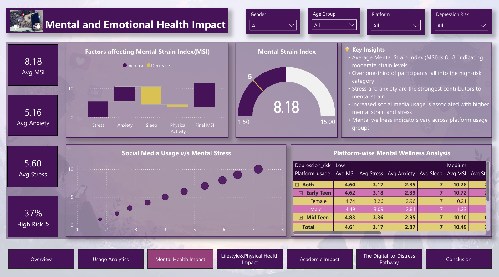
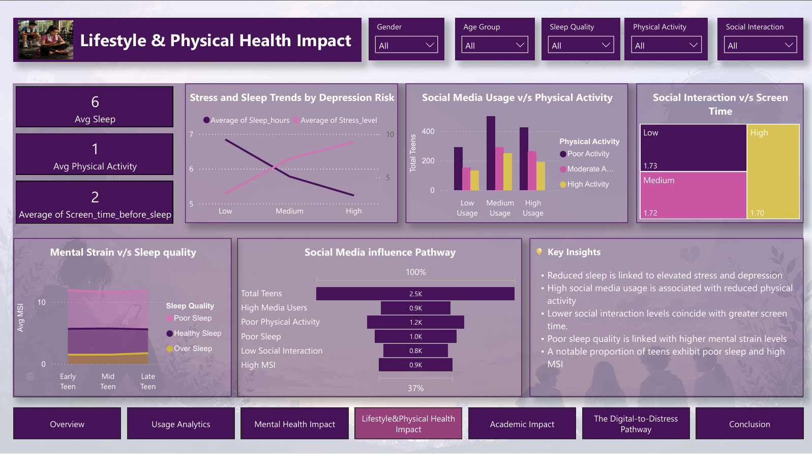
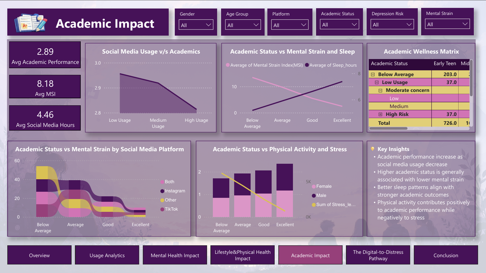
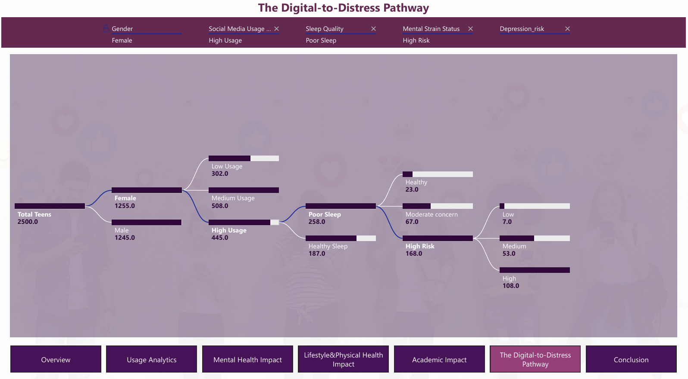
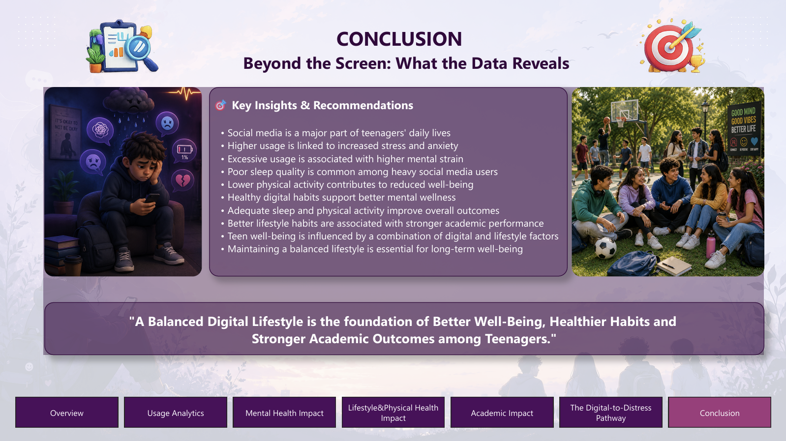

# Social Media Influence on Teen Lifestyle & Well-Being

A Power BI dashboard project that analyzes social media usage patterns and their relationship with wellness, lifestyle behaviors, and academic outcomes among adolescents.

## Objectives

- Analyze social media usage patterns
- Evaluate mental well-being
- Assess lifestyle impacts
- Examine academic outcomes

## Dataset

- **Source:** Kaggle, Teen Social Media Usage & Mental Health
- **Records:** 2,500 teens
- **Age range:** 13-19
- **Platforms:** Instagram, TikTok, Both, Other
- **Key attributes:** Age, Gender, Daily Social Media Hours, Platform Usage, Sleep Hours, Screen Time Before Sleep, Academic Performance, Physical Activity, Social Interaction Level, Stress Level, Anxiety Level, Depression Label

## Tools & Technologies

- **Excel / Power Query:** data cleaning, transformation, pivot tables
- **Power BI:** interactive multi-page dashboard
- **DAX:** KPI, wellness, lifestyle, usage, gauge, waterfall, and academic measures

## Data Preprocessing

- Checked for duplicates and missing values (none found)
- Standardized formats: capitalized column names, consistent `Male`/`Female` and `Low`/`Medium`/`High` values, rounded academic performance to 1 decimal place, applied Clean and Trim
- Corrected data types for all columns
- Created calculated columns:

| Column | Logic |
|--------|-------|
| Mental Strain Index (MSI) | (Stress level + Anxiety level) / 2 |
| Mental Strain Status | Healthy (MSI ≤ 5), Moderate Concern (≤ 10), High Risk (above 10) |
| Age Group | Early Teen (≤ 14), Mid Teen (≤ 18), Late Teen (above 18) |
| Sleep Quality | Poor Sleep (≤ 6 hrs), Healthy Sleep (≤ 8.9 hrs), Over Sleep (above 8.9) |
| Academic Status | Below Average, Average, Good, Excellent |
| Social Media Usage Status | Low, Medium, High usage (based on screen time before sleep) |
| Physical Activity Status | Poor, Moderate, High activity |

- Built pivot tables: platform-wise average stress, gender-wise depression risk, age group-wise social media hours, academic performance by screen time before sleep, and mental strain status by physical activity

## Dashboard Pages

### 1. Overview & Navigation
Project introduction, key performance indicators (KPIs), and navigation.

### 2. Social Media Usage Analytics
Platforms, age groups, gender, and usage intensity.

### 3. Mental Health Impact
Stress, anxiety, depression risk, and Mental Strain Index (MSI).

### 4. Lifestyle & Physical Health Impact
Sleep quality, physical activity, and social interaction.

### 5. Academic Influence
Academic performance versus digital habits and well-being.

### 6. Decomposition Tree Analysis
Explore pathways associated with high mental strain.

### 7. Conclusion & Recommendations
Summary of findings and actionable recommendations.

**Visuals used:** Gauge, Waterfall, Ribbon, Funnel, Treemap, Scatter, Line & Area charts, Matrix, Decomposition Tree, slicers, cards, tooltips, drill-down, and page navigation buttons.

## Key DAX Measures

- `Total Teens`, `Total Male`, `Total Female`, `Platforms Used`
- `Avg Stress`, `Avg Anxiety`, `Avg MSI`, `High Risk`, `High Risk %`
- `Avg Sleep`, `Avg Physical Activity`, `Avg Social Media Hours`, `High Media Users`
- `Min-MSI`, `Max-MSI`, `Target MSI` (gauge) and `Waterfall Value` (waterfall)
- `Avg Academic Performance`

## Key Findings

- Average daily social media usage is about **4.46 hours**.
- Higher usage is associated with higher Mental Strain Index scores, and stress and anxiety are the major contributors.
- Poor sleep quality and lower physical activity are linked to higher mental strain.
- Better sleep and lower mental strain generally correspond to stronger academic outcomes.
- The most significant pathway to high mental strain combines high social media usage, poor sleep, low physical activity, and high depression risk.

## Recommendations

- **Promote responsible social media usage:** encourage balanced, mindful digital engagement.
- **Improve sleep hygiene:** reduce screen exposure before bedtime and keep consistent sleep schedules.
- **Encourage physical activity:** promote regular exercise and outdoor activities.
- **Strengthen social interaction and academic well-being:** support healthy offline engagement, time management, and study habits.

## Repository Contents

| File | Description |
|------|-------------|
| `Teen_Mental_Health_Dataset (1).csv` | Raw dataset |
| `Mini Project.xlsx` | Cleaned data, calculated columns, and pivot tables |
| `Mini Project.pbix` | Power BI dashboard |
| `MINI Project_Report PDF.pdf` | Full project report |
| `Social Media Influence on Teen Lifestyle & Well...` | PowerPoint Presentation |

## How to View

1. Clone or download this repository.
2. Open `Mini Project.pbix` in Power BI Desktop to explore the dashboard.
3. Open `Mini Project.xlsx` in Excel to see the cleaned data and pivot tables.
4. Read `MINI Project_Report PDF.pdf` for the full report.

## Author

**Arya R**
GitHub: [@aryar96](https://github.com/aryar96)
